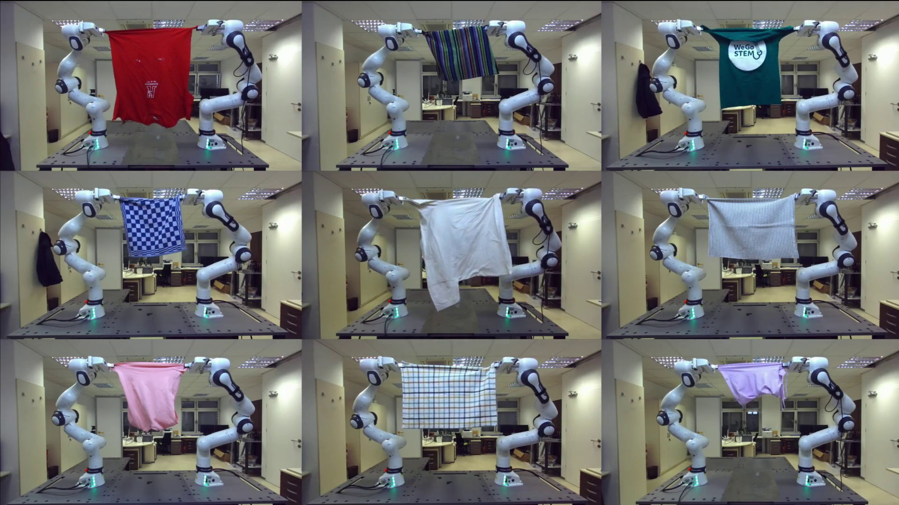
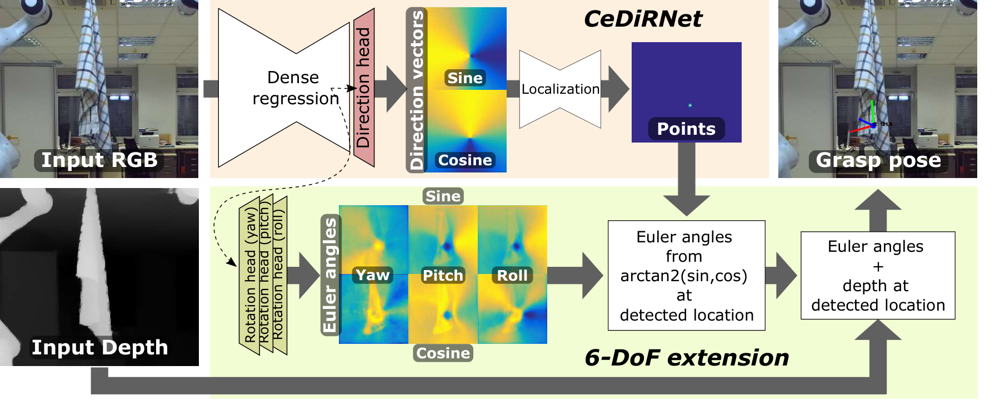
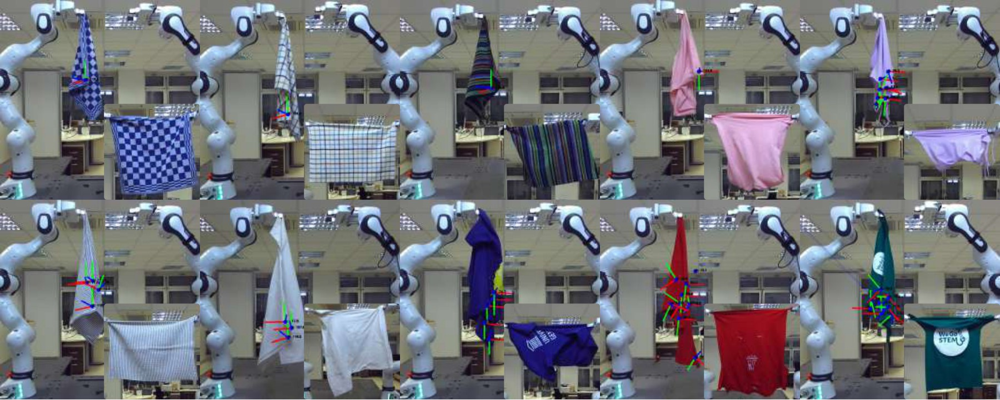

# Vision-Based 6-DoF Grasp Pose Estimation for Robot Cloth Unfolding

**CeDiRNet-6DoF · IEEE Transactions on Cybernetics, 2026**

Domen Tabernik · Peter Nimac · Jan Jerićević · Danijel Skočaj · Andrej Gams

**[arXiv](https://arxiv.org/abs/2609.31452) · [IEEE paper](https://ieeexplore.ieee.org/document/11700396) · [Supplementary video](https://data.vicos.si/skokec/rtfm/CeDiRNet-6DoF/cedirnet_demo_h264_1080p_submission.mp4) · [Pretrained models](#models) · [Dataset](#dataset-setup) · [Citation](#citation)**

CeDiRNet-6DoF predicts where and how to grasp hanging cloth so that a second robot arm can stretch it open. From a single RGB observation, the network localizes grasp candidates and estimates the gripper's full 3D orientation; measured depth and camera calibration complete each 6-DoF pose. This repository provides the paper's learning and inference code, pretrained RGB/RGB-D models, and dataset sidecar masks.

🏆 🥈 The method achieved **second place at the [ICRA 2024 Cloth Competition](https://airo.ugent.be/cloth_competition/)**, a robotic cloth-manipulation challenge. In the paper's subsequent robot evaluation on the competition item set, it achieved **61.3% cloth coverage and 72.5% grasp success**; the full results and protocol distinctions are [below](#reported-robot-results).[1]

The paper is available on [arXiv (2609.31452)](https://arxiv.org/abs/2609.31452). The original journal publication is available through [IEEE Xplore](https://ieeexplore.ieee.org/document/11700396) ([DOI: 10.1109/TCYB.2026.3732543](https://doi.org/10.1109/TCYB.2026.3732543)).

## Supplementary video

[](https://data.vicos.si/skokec/rtfm/CeDiRNet-6DoF/cedirnet_demo_h264_1080p_submission.mp4)

**▶ [Watch the full supplementary video (MP4)](https://data.vicos.si/skokec/rtfm/CeDiRNet-6DoF/cedirnet_demo_h264_1080p_submission.mp4)** — predicted grasps, intermediate execution states, and unfolded outcomes. Click the image to play the externally hosted video; no video download is included in a clone.

## Method and architecture



1. **Localize a grasp.** A ConvNeXt + FPN backbone predicts dense center-direction fields, and a localization network extracts candidate image points.
2. **Estimate orientation.** Three parallel heads regress sine/cosine pairs for roll, pitch, and yaw; orientation is read at each detected point.
3. **Recover the 6-DoF pose.** Sensor depth lifts the image point into 3D, and camera calibration transforms the pose into the world frame.

The shared dense head also predicts log-distance and cloth segmentation as auxiliary training tasks. Fully supervised training uses annotated grasp poses and uncertainty-weighted losses. Joint segmentation, randomized backgrounds, and robot-workspace cropping improve transfer to the robot setup. Figure: author-source architecture from the paper, Figure 1.[1]



*Predicted grasp poses and corresponding unfolded outcomes from the paper's Figure 4. The supplementary video shows the execution sequences.*[1]

**Getting started:** [Install](#installation) → [prepare data](#dataset-setup) → [run one observation](#one-shot-inference). For learning, see [training and evaluation](#training-and-evaluation); for integration, see [Docker inference](#docker-inference) and [folder-serving deployment](deploy/README.md).

## Models

| Variant | Network input | Image region | Checkpoint | Extra inference requirements |
| --- | --- | --- | --- | --- |
| `crop_rgb` | RGB | robot-workspace crop | [`cedirnet6dof_crop_rgb.pth`](https://data.vicos.si/skokec/rtfm/CeDiRNet-6DoF/cedirnet6dof_crop_rgb.pth) | camera intrinsics/extrinsics, depth map for 3D lifting, robot base/TCP poses for crop |
| `nocrop_rgb` | RGB | full image | [`cedirnet6dof_nocrop_rgb.pth`](https://data.vicos.si/skokec/rtfm/CeDiRNet-6DoF/cedirnet6dof_nocrop_rgb.pth) | camera intrinsics/extrinsics, depth map for 3D lifting |
| `crop_rgbd` | RGB-D | robot-workspace crop | [`cedirnet6dof_crop_rgbd.pth`](https://data.vicos.si/skokec/rtfm/CeDiRNet-6DoF/cedirnet6dof_crop_rgbd.pth) | camera intrinsics/extrinsics, depth map, robot base/TCP poses for crop and depth normalization |

Public checkpoint URLs and SHA256 checksums are listed in `models/model_definitions.json`. The inference script downloads missing checkpoints into `models/` from those URLs and verifies their checksums. **Start with `crop_rgb`**, the best RGB configuration in the paper. See [checkpoint provenance and reproduction boundaries](models/README.md), including the RGB-D normalization setting.

## Reported robot results

The paper's best RGB model uses segmentation supervision, background randomization,
and robot-workspace cropping. The paper reports these **combined RUNS A+B** results:

| Evaluation set | Coverage | Grasp success | Coverage for successful grasps |
| --- | ---: | ---: | ---: |
| ICRA 2024 items | 61.3% | 72.5% | 72.6% |
| Additional items (Our Set) | 57.4% | 62.5% | 70.4% |
| Overall | 59.4% | 67.5% | 71.5% |
| Overall, unseen items only | 58.3% | 67.5% | 69.5% |

These are **physical robot trial results**, not scores computed by the offline
evaluation script. They cover 16 cloth items (12 unseen during training), with ten
trials per item across the two runs. Coverage measures unfolded cloth area relative
to its reference area. Camera, robot, gripper, calibration, and initial cloth
configuration affect the result; running inference on an image does not reproduce
this experiment. See [the paper](https://doi.org/10.1109/TCYB.2026.3732543) for the
protocol, item-wise results, and ablations.

The actual **ICRA 2024 competition result was second place with 57% coverage**.
The 61.3% above is a later evaluation on the ICRA item set, not the competition
score. The RGB-D model is an additional variant, not the checkpoint underlying
this RGB table. The public `crop_rgb` file exactly matches the original training
and robot-evaluation checkpoint for this model; the table remains a report of
the paper’s trials, not a new benchmark run of this release.

## Installation

Use **Python 3.10**. The pinned `timm==0.6.12` fails to import under Python 3.11;
do not upgrade SMP/timm independently, because newer versions change checkpoint
structure. The provided environment selects CUDA 12.8 / PyTorch 2.7 wheels for
recent NVIDIA GPUs. A sufficiently recent host NVIDIA driver is required.

All three released checkpoints have passed real-sample **CPU inference with
Python 3.10 and PyTorch 2.7** (CUDA 12.6 wheel build). CUDA 12.8 GPU execution and
the Docker image still require runtime verification; this is not a claim of
validated Blackwell performance.

```bash
conda env create -f environment.yml
conda activate CeDiRNet-6DoF-public
# or, in an existing Python 3.10 env:
pip install -r requirements.txt
export PYTHONPATH="$PWD/src:${PYTHONPATH:-}"
```

OpenCV may require system packages such as `libgl1`/`libglib2.0-0`.

## Dataset setup

Download the original ICRA 2024 cloth-competition dataset from Zenodo and apply the CeDiRNet-6DoF sidecar masks:

```bash
wget -O ICRA_2024_cloth_competition_dataset.zip \
  'https://zenodo.org/records/14621179/files/ICRA_2024_cloth_competition_dataset.zip?download=1'
wget -O icra2024_dataset_fixes.zip \
  https://data.vicos.si/skokec/rtfm/CeDiRNet-6DoF/icra2024_dataset_fixes.zip
```

See [`dataset/README.md`](dataset/README.md) for full dataset download, unpacking, and sidecar instructions. The local generated copy is ignored by git:

```text
dataset/icra2024_dataset_fixes.zip
samples: 503
sidecar files: 503 (cloth_segmentation.png only; no grasp/ folders)
sha256: b6dd0a967d1df0749119d7d92e9e874d0968cce353afa12a675f1cc5ab3877e3
```

Set the dataset path after unpacking:

```bash
export CLOTH_COMPETITION_ICRA2024_DATASET=/path/to/ClothCompetitionICRA2024/datasets
```

Optional COCO background augmentation is enabled only when both variables are provided:

```bash
export COCO_BG_DIR=/path/to/COCO/train2017
export COCO_BG_IMAGES=/path/to/bg_coco_train_2017.txt
```

If these variables are absent, training runs **without** COCO replacement-background augmentation and does not reproduce the background-randomized model reported above.

## Training and evaluation

Train or evaluate the released variants:

```bash
# released default variants: crop_rgb, nocrop_rgb, crop_rgbd
./scripts/run_training_and_evalution.sh train
./scripts/run_training_and_evalution.sh eval

# one variant only
VARIANTS=crop_rgb ./scripts/run_training_and_evalution.sh train
VARIANTS=crop_rgbd ./scripts/run_training_and_evalution.sh eval
```

Optional dry run to verify imports and configuration without starting learning/evaluation:

```bash
./scripts/run_training_and_evalution.sh dry_run
```

Environment knobs for config imports/runs:

- `VARIANTS="crop_rgb nocrop_rgb crop_rgbd"` to choose released variants in the shell helper
- `DEPTH_ENCODING=off|3d_arm_plane`
- `CROP_MODE=robot|off`
- `CLOTH_COMPETITION_BACKBONE=tu-convnext_base`
- `OUTPUT_DIR=./exp`
- `PRETRAINED_MODEL_DIR=./models`
- `COCO_BG_DIR` and `COCO_BG_IMAGES` for optional background augmentation

The shell helper also accepts plural low-level knobs `DEPTH_ENCODINGS`, `CROP_MODES`, and `BACKBONES` for custom sweeps.

## One-shot inference

Input can be either a sample folder containing `observation_start/` or the `observation_start/` folder itself.

Required files for inference:

```text
observation_start/image_left.png
observation_start/depth_map.tiff
observation_start/camera_intrinsics.json
observation_start/camera_pose_in_world.json
```

For cropped variants, the robot-workspace crop is computed from competition-style pose files containing 3D translations and rotations in the world frame:

```text
observation_start/arm_left_pose_in_world.json         # left crop reference point: left robot base
observation_start/arm_right_pose_in_world.json        # right crop reference point: right robot base
observation_start/arm_left_tcp_pose_in_world.json     # top crop reference point: left TCP, shifted +0.05 m in world Z
observation_start/arm_right_tcp_pose_in_world.json    # required by the helper for compatibility
```

For RGB-D variants, `arm_left_pose_in_world.json` and `arm_right_pose_in_world.json` are also used to normalize depth by the vertical plane through the robot bases.

Even the RGB-only models require a depth map and camera calibration at inference time to lift the predicted pixel grasp into a 3D world-frame pose. "RGB" means depth is not an input channel to the neural network; "RGB-D" means arm-base-plane depth is also provided to the network.

Example via the simple demo wrapper:

```bash
MODEL_CHECKPOINT=models/cedirnet6dof_crop_rgb.pth \
OBSERVATION_FOLDER=/path/to/sample_000000 \
./scripts/run_demo_inference.sh
```

Equivalent direct Python call:

```bash
python tools/infer_observation.py \
  --observation-folder /path/to/sample_000000 \
  --variant crop_rgb \
  --model-checkpoint models/cedirnet6dof_crop_rgb.pth
```

Output:

```text
sample_000000/grasp_predicted/grasp_pose.json
sample_000000/grasp_predicted/frontal_image_grasp.jpg
```

`grasp_pose.json` is a list of candidate grasps with `position_in_meters`, `rotation_euler_xyz_in_radians`, and `score`.

## Docker inference

Build:

```bash
docker build -t cedirnet-6dof:latest .
```

Run:

```bash
docker run --rm --gpus all \
  -v /path/to/sample_000000:/data/sample:ro \
  -v "$PWD/models:/app/models:ro" \
  -v /path/to/output:/data/output \
  cedirnet-6dof:latest \
  --observation-folder /data/sample \
  --output-dir /data/output \
  --variant crop_rgb \
  --model-checkpoint /app/models/cedirnet6dof_crop_rgb.pth
```

For CPU-only testing, add `--device cpu` and omit `--gpus all`.

For fixed-model competition-style folder serving and model-selectable robot
experiment serving, see [`deploy/README.md`](deploy/README.md). Separate Docker
recipes are provided for each interface. They are **portable reconstructions**,
not archived competition binaries or robot controllers; historical differences
and unverified container execution are documented there.

## Cropping and workspace assumptions

The cropped variants crop the image around the robot workspace. In the default helper, the crop bounds are obtained by projecting 3D world-frame reference points into the camera image using `camera_intrinsics.json` and `camera_pose_in_world.json`:

- left boundary: translation from `arm_left_pose_in_world.json`
- right boundary: translation from `arm_right_pose_in_world.json`
- top boundary: translation from `arm_left_tcp_pose_in_world.json`, shifted by `+0.05 m` along world `Z`
- bottom boundary: the lower image projection of the two robot-base points

If your setup does not provide these robot poses, use the `nocrop_rgb` model or adapt `tools/infer_observation.py` to provide an equivalent crop/window for your camera and workspace.

## Release checks

```bash
python -m unittest discover -s tests -v
```

Tests cover model preprocessing, training configuration separation, batching,
packaging, morphology, and the folder-serving protocol. They do not replace
checkpoint inference or physical robot evaluation. See [reproduction
boundaries](models/README.md) before comparing a retrained model with paper scores.

## Known limitations

- The model was developed for the ICRA 2024 cloth-unfolding setup and camera/robot geometry. Domain shifts in cloth appearance, camera pose, lighting, robot layout, and gripper geometry can reduce performance.
- Cropped models assume that the robot workspace crop contains the relevant cloth region. Incorrect robot calibration or a crop that excludes the graspable region will fail.
- Depth variants use arm-base-plane depth normalization and need calibrated camera + robot-base poses.

## License

This code is released under the Creative Commons Attribution-NonCommercial 4.0 International license; see [`license.txt`](license.txt). Incorporated third-party code retains its own license notices; see [`THIRD_PARTY_NOTICES.md`](THIRD_PARTY_NOTICES.md). Check dependency, dataset, and model licensing separately.

## Citation

If you use this code or the released models, please cite the corresponding paper:

```bibtex
@article{tabernik2026vision,
  author  = {Domen Tabernik and Peter Nimac and Jan Jeri{\'{c}}evi{\'{c}} and Danijel Sko{\v{c}}aj and Andrej Gams},
  title   = {Vision-Based {6-DoF} Grasp Pose Estimation for Robot Cloth Unfolding},
  journal = {IEEE Transactions on Cybernetics},
  year    = {2026},
  doi     = {10.1109/TCYB.2026.3732543},
  url     = {https://ieeexplore.ieee.org/document/11700396},
  note    = {Early access; final issue pagination pending}
}
```

## Sources

[1] https://ieeexplore.ieee.org/document/11700396 — Vision-Based 6-DoF Grasp Pose Estimation for Robot Cloth Unfolding
